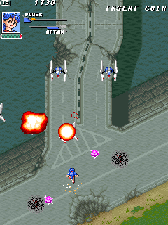
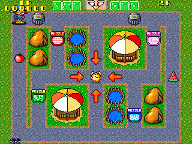

# Silver Millennium / PuzzLove (Para) for MiSTer

The games of MAME's `f32/silvmil.cpp` driver, Para's "Tumble Pop"-derived board (68000 at 12 MHz; Z80 with a YM2151 and an
OKI M6295; two 64 x 32 tilemaps of 16 x 16 tiles and a DECO 52-style sprite generator in its bootleg mode), for the MiSTer FPGA
platform:

| Game | Set | MRA |
|---|---|---|
| Silver Millennium (1995), vertical | `silvmil` | `mra/Silver Millennium.mra` |
| PuzzLove (1994) | `puzzlove` | `mra/PuzzLove.mra` |
| PuzzLove (Korea) | `puzzlovek` | `mra/_alternatives/_PuzzLove/PuzzLove (Korea).mra` |

| Silver Millennium | PuzzLove |
|---|---|
|  |  |

Pictures as the core's simulation draws them (identical to MAME 0.289's).

Written for MiSTer from MAME 0.289's driver and its sprite chip (`decospr.cpp`), on the owner's Cross Pang core (the same family of
boards: `rtl/UPSTREAM.md`). The 68000 is [fx68k](https://github.com/ijor/fx68k) (Jorge Cwik), the Z80 is
[TV80](https://github.com/hoglet67/tv80) (Guy Hutchison), the YM2151 is [jt51](https://github.com/jotego/jt51) and the OKI M6295
[jt6295](https://github.com/jotego/jt6295) (Jose Tejada), the CRT Adjust page is rmonic79's
[MiSTer-CRT-Adjust](https://github.com/rmonic79/MiSTer-CRT-Adjust). The platform layer (SDRAM controller, loader, program cache, fast
load) is the owner's, from the Cross Pang, Oh My God!, MCatAdv and Metro cores; the SDRAM controller descends from the Gaiapolis core
that **plasticbugs** wrote for the Analogue Pocket. No ROMs or other copyrighted data are in this repository; you supply your own
MAME romsets.

## Status

**Tested on a real MiSTer** by the repository owner (`silvmil_20261028`): all three sets load and play.

See `docs/status.md` for what was checked and how, against MAME 0.289, in simulation and in the Quartus tool flow.

## Install

1. Unzip `SilverMillennium_MiSTer_<date>.zip` (from the GitHub release) over the root of the SD card: it puts the MRAs in `_Arcade/`
   (PuzzLove (Korea) in `_Arcade/_alternatives/`) and the core in `_Arcade/cores/`. From the repository instead:
   `releases/silvmil_YYYYMMDD.rbf` to `/media/fat/_Arcade/cores/` and the contents of `mra/` to `/media/fat/_Arcade/`. Keep the RBF's
   `silvmil_` name and date: MiSTer finds the core by the MRA's `<rbf>` name plus the date. Delete older `silvmil_*.rbf` files.
2. Put your MAME 0.289 romsets in `/media/fat/games/mame/`: `silvmil.zip`, `puzzlove.zip` (a merged set holds PuzzLove (Korea); with
   split sets add `puzzlovek.zip`).
3. Start a game from the Arcade menu. With a recent Main_MiSTer the ROM loads in a moment (fast loading: the MRAs' `address=` makes
   Main_MiSTer copy the image into the DDR3, the core reads it back); an older Main_MiSTer ignores it and loads the ordinary way.
4. Define the buttons once per game (OSD): each MRA names them, in the order Button 1, Button 2, Start, Coin.

## Controls

A joystick per player, Start and Coin; on the keyboard, MAME's defaults (1 / 2 start, 5 / 6 coin). The buttons:

| Game | Button 1 | Button 2 |
|---|---|---|
| Silver Millennium | **Shot**: one shot per press (no auto-fire) | **Bomb**: a burst of flame around the ship |
| PuzzLove | **Jump**: the player jumps along the path and picks up what is there | **Extra Time**: one of the stock items (the dots at the left of the field) for ten more seconds on the timer |

The names come from pressing each button in MAME (`docs/status.md`). MAME 0.289 gives both games a third button; neither game reacts
to it, so the MRAs leave it out.

There is no service button: for the test mode set the **Service Mode** DIP switch and reset the core (as in MAME).

## OSD

* **Aspect ratio**, **Scale** (Normal, V-Integer, HV-Integer, Narrower HV-Integer, HV-Integer+): for the HDMI scaler; with Full
  Screen and an integer Scale the screen's own proportions stand in, so the picture stays a whole-number size. Scale works in both
  orientations: for the turned picture the core works the size out with the turned width and height.
* **Orientation** (Silver Millennium only): *Vert* (default) turns the picture for the HDMI output through a frame buffer in the DDR3
  (the framework's `screen_rotate`; MAME's ROT270); *Horz* shows the raster as it is, for a monitor turned on its side. The analog
  output always shows the raster as it is.
* **Flip Screen**: the picture turned 180 degrees, on every output (HDMI, turned or not, and analog). The board has no flip of its
  own and neither game offers one in its DIP switches or service mode, so the core turns the picture itself: each line is drawn from
  the opposite line of the board's picture, right to left. No frame buffer, no added lag.
* **Scandoubler Fx** (HQ2x, CRT 25 / 50 / 75 %): the framework's.
* **CRT Adjust** (H-Size, H-Position, V-Shift): for the 15 kHz output, through rmonic79's line buffer; the horizontal sync stays
  native so the CRT keeps its lock. It is off while the scandoubler is in use (Scandoubler Fx or MiSTer.ini's `forced_scandoubler`):
  its blanking would leave the doubled picture without a vertical sync.
* **DIP switches**: each game's, as MAME 0.289 defines them, with MAME's defaults. Reset after a change.
* **Volume**: Normal is MAME's mix (the YM2151's two outputs and the OKI, each at MAME's route 0.25, clipped to 16 bits), then 6 / 12
  / 18 dB lower.
* **Video RAM**: *At vblank (MAME)* (default) copies the tile and sprite RAMs and the scroll / bank registers at the start of
  vertical blank and draws the next frame from the copy, as MAME draws a frame. *Live (less lag)* reads them as each line is drawn.
  The palette is always looked up as the dots go out.
* **SDRAM read capture**: a diagnostic for SDRAM modules that answer late.

## Timing

96 MHz machine clock; 68000 12 MHz; Z80 4.096 MHz (PuzzLove 4 MHz); YM2151 3.579545 MHz (PuzzLove (Korea) 3.75 MHz); OKI 1.024 MHz
(PuzzLove 1 MHz), pin 7 high -- the board's three crystals as the driver lists them per set; dot clock 6 MHz (/16); 384 x 260 total,
320 x 240 visible, 60.096 Hz, 15.625 kHz. MAME gives a 320 x 240 window at exactly 60 Hz with no vertical blank time; the board's real
timing is not known.

## Build

Quartus Prime Lite 17.0 (MiSTer's toolchain): open `Silvmil.qpf` or `quartus_sh --flow compile Silvmil`. The MRAs are written by
`python tools/make_mra.py` (it reads MAME 0.289's romsets and `src/mame/f32/silvmil.cpp`; `tools/paths.py` says where).

## Simulation (Verilator 5 in WSL)

```
sim/run.sh <image> 2 <out> +state=<MAME state prefix> +first=1 +foff=-1 [+flip]   # one frozen MAME state, vs MAME's pixels
sim/run.sh <image> <frames> <out> +inputs=<replay> +first=58 +wav +mix            # the whole machine from reset with MAME's inputs
sim/run.sh <image> 0 <out> +load=fast                                            # the fast load from a DDR3 model, checked word by word
sim/sd/sweep.sh                                                                  # the framework's scandoubler, with CRT Adjust
```
`python tools/silvmil_image.py build <set> <out.rom>` makes an image (the bytes the MRA delivers). `tools/capture.py` with
`tools/lua/dump_state.lua` makes MAME 0.289's states and input replays; `tools/silvmil_ref.py`, `tools/corpus_rtl.py`,
`tools/sys_match.py` and `tools/cmp_audio.py` compare; `tools/probe.py` presses inputs in MAME. They expect a scratch folder `work/`
next to the repository (MAME's dumps and the ROM images; never committed); `tools/paths.py` names the environment variables for MAME,
the romsets and MAME's source.

## Release

`python tools/release.py` copies a finished build into `releases/` with its fitter / timing / RAM-depth reports;
`python tools/package.py` writes `dist/SilverMillennium_MiSTer_<date>.zip` (the SD card structure: `_Arcade/**/*.mra`,
`_Arcade/cores/*.rbf`; no ROMs).

## Credits

fx68k (Jorge Cwik), TV80 (Guy Hutchison), jt51 and jt6295 (Jose Tejada), MiSTer-CRT-Adjust (rmonic79), the Pocket Gaiapolis core's
SDRAM controller and `mra_build.py` (plasticbugs), the MiSTer framework (Sorgelig and contributors), MAME (David Haywood wrote the
Silver Millennium driver; Bryan McPhail and David Haywood the DECO sprite chip).

## Licence

GPL-3.0-or-later (fx68k, jt51 and jt6295 are GPL-3.0, TV80 is MIT, MiSTer-CRT-Adjust GPL-3.0-or-later).
